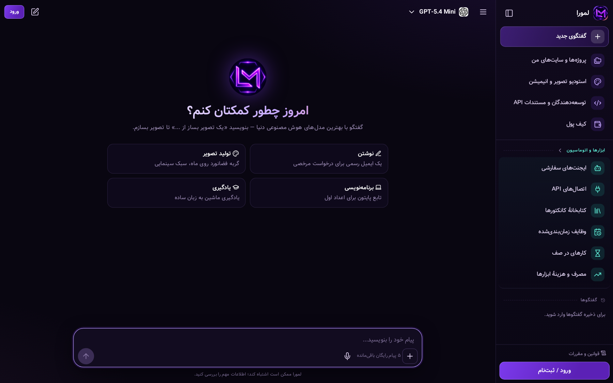
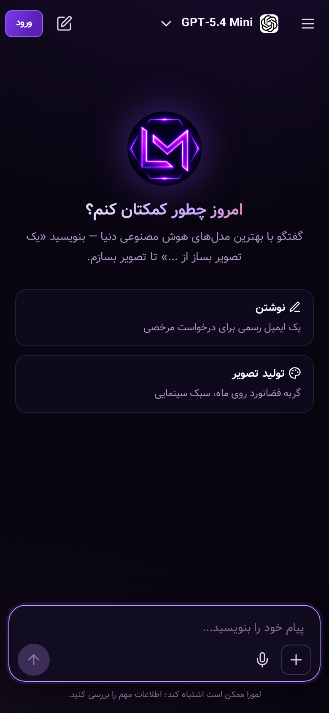
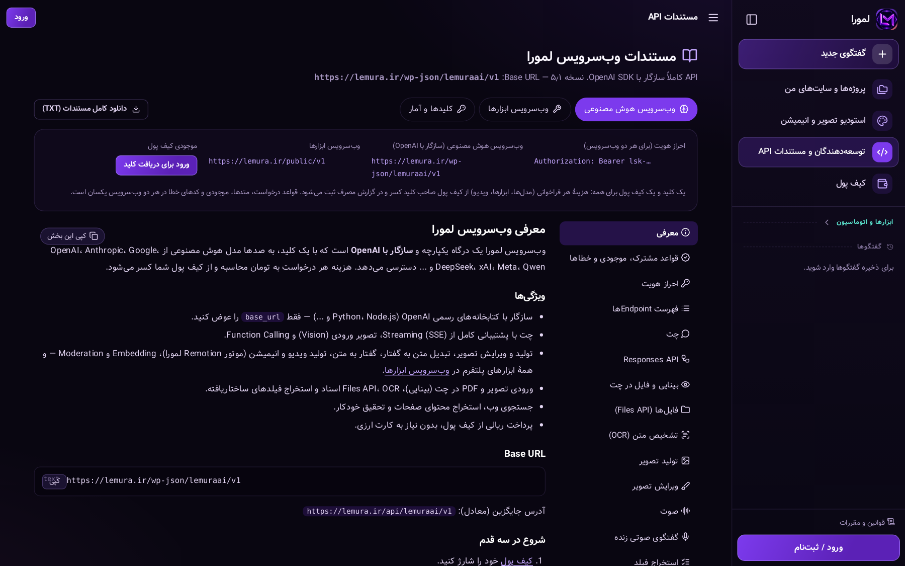
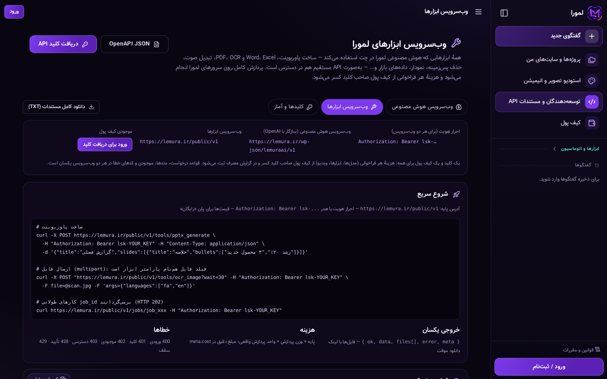
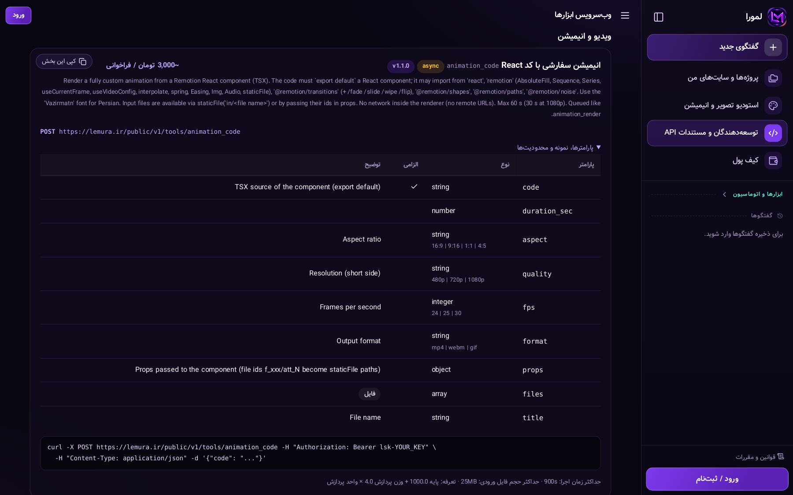

<p align="center">
  <a href="https://lemura.ir"></a>
</p>

<p align="center">
  <a href="https://lemura.ir"></a>
  <a href="docs/ai-api.md"></a>
  <a href="docs/tools-api.md"></a>
  
</p>

<p align="center">
  <a href="#-امکانات"><b>امکانات</b></a> ·
  <a href="#-تصاویر"><b>تصاویر</b></a> ·
  <a href="#-وب‌سرویس‌ها"><b>وب‌سرویس‌ها</b></a> ·
  <a href="#-مستندات"><b>مستندات</b></a> ·
  <a href="#-ساختار-مخزن"><b>ساختار مخزن</b></a> ·
  <a href="#-developer-quick-start"><b>English</b></a>
</p>

<div dir="rtl">

## ⚡ لمورا چیست؟

**هوش مصنوعی لمورا** یک پلتفرم فارسی و ایجنتیک هوش مصنوعی است: با بهترین مدل‌های دنیا گفتگو کنید، در همان گفتگو
تصویر و **ویدیوی موشن‌گرافیک** بسازید، از **۲۹ ابزار** (پاورپوینت، Word، Excel، PDF، OCR، تبدیل صوت، حذف پس‌زمینه،
نمودار، بازار سهام و رمزارز، RAG و...) استفاده کنید، **ایجنت سفارشی** بسازید، **APIهای خودتان** را وصل و **زمان‌بندی**
کنید — و همهٔ این‌ها را از طریق **دو وب‌سرویس** با یک کلید و یک کیف پول تومانی در برنامه‌های خودتان هم داشته باشید.

<p align="center"><b>👈 همین حالا امتحان کنید: <a href="https://lemura.ir">lemura.ir</a></b></p>

> [!TIP]
> **📘 مستندات کامل:** [وب‌سرویس هوش مصنوعی](docs/ai-api.md) · [وب‌سرویس ابزارها](docs/tools-api.md) ·
> [نسخهٔ گرافیکی یک‌صفحه‌ای](docs/index.html) · [OpenAPI ابزارها](docs/openapi-tools.json) ·
> [نسخهٔ آنلاین](https://lemura.ir/docs)

> [!NOTE]
> این مخزن فقط **فرانت‌اند** لمورا است: قالب‌های صفحه (Jinja2)، استایل‌ها، اسکریپت‌های مرورگر، آیکون‌ها، فونت‌ها و
> مستندات عمومی API. کد سرور، پنل مدیریت، موتور ابزارها، درگاه پرداخت، کلیدها و تنظیمات عمداً در این مخزن **نیستند**.

</div>

<p align="center">
  <a href="https://lemura.ir"></a>
</p>

<div dir="rtl">

## ✨ امکانات

| | بخش | توضیح |
|:-:|---|---|
| 💬 | **گفتگوی هوشمند** | رابط به سبک ChatGPT با بهترین مدل‌ها؛ پاسخ زنده که روی سرور کامل می‌شود — با رفرش یا قطع اینترنت از دست نمی‌رود؛ پاسخ‌های طولانی (کد، HTML) نیمه‌کاره نمی‌مانند |
| ➕ | **منوی + در چت** | به‌صورت پیش‌فرض فقط «+»، میکروفون و ارسال؛ منوی + شامل بارگذاری فایل، جستجوی وب، حالت «تولید تصویر و انیمیشن» و انتخاب تک‌تک ابزارها |
| 🎨 | **استودیو تصویر و انیمیشن** | تصویر با مدل‌های تصویرسازی؛ انیمیشن و ویدیو با موتور **Remotion** (قاب ۱۶:۹ / ۹:۱۶ / ۱:۱ / ۴:۵، کیفیت تا ۱۰۸۰p، تصویر و موسیقی دلخواه) |
| 🎙️ | **ورودی صوتی** | دیکته: صحبت کنید، به متن تبدیل و ارسال می‌شود و پاسخ متنی می‌گیرید |
| 🛠️ | **۲۹ ابزار** | اسناد (PPTX/DOCX/XLSX/PDF)، OCR، صوت، تصویر، پردازش زبان فارسی، آرشیو، نمودار، بازار، RAG، مرورگر، انیمیشن — [فهرست کامل](docs/tools-api.md) |
| 🤖 | **ایجنت‌های سفارشی** | دستورالعمل، مدل (از فهرست مجاز) و تک‌تک ابزارها با عنوان و توضیح فارسی؛ کانکتورها هم به‌عنوان مهارت |
| 🔌 | **اتصال‌های API** | فایل OpenAPI یا مستندات را بدهید ← پیش‌نویس ← تست ← فعال؛ کلیدها رمزنگاری‌شده |
| 📚 | **کتابخانهٔ کانکتورها** | اتصال‌های عمومی که دیگران منتشر کرده‌اند را با کلید خودتان فعال کنید |
| ⏰ | **وظایف زمان‌بندی‌شده** | اجرای خودکار (cron / بازه / یک‌بار) با تأیید، توقف و «اجرای فوری» |
| ⏳ | **صف کارها** | اجرای پس‌زمینه حتی وقتی آفلاین هستید؛ تلاش مجدد؛ نتیجه خودکار در همان گفتگو |
| 🗂️ | **پروژه‌ها و ایجنت سایت** | اتصال سایت با وردپرس، سی‌پنل یا SSH؛ برنامه، تأیید هر تغییر، گزارش کار |
| 🧑‍💻 | **توسعه‌دهندگان و مستندات** | یک بخش در سایدبار: دو وب‌سرویس، کلیدها و آمار، مصرف؛ کپی هر بخش، دانلود TXT، موجودی زنده، فایل‌های قابل دانلود (افزونه‌ها) |
| 👛 | **کیف پول تومانی** | پرداخت به اندازهٔ مصرف؛ هزینهٔ هر ابزار و هر درخواست شفاف |
| 🌐 | **فارسی / English** | رابط کامل دوزبانه؛ آیکون‌های یکپارچهٔ Lucide؛ بخش ابزارها و اتوماسیون با رنگ فیروزه‌ای مجزا |

</div>

## 📸 تصاویر

<table>
  <tr>
    <td width="68%"><a href=".github/screens/chat.png"></a></td>
    <td width="32%"><a href=".github/screens/chat-mobile.png"></a></td>
  </tr>
  <tr>
    <td colspan="2" align="center"><sub>گفتگو — سایدبار با بخش «ابزارها و اتوماسیون» · نوار نوشتن با «+»، میکروفون و ارسال · نسخهٔ موبایل</sub></td>
  </tr>
  <tr>
    <td colspan="2"><a href=".github/screens/docs.png"></a></td>
  </tr>
  <tr>
    <td colspan="2" align="center"><sub>توسعه‌دهندگان و مستندات API — تب‌های دو وب‌سرویس، کلید و موجودی مشترک، کپی هر بخش و دانلود TXT</sub></td>
  </tr>
  <tr>
    <td width="50%"><a href=".github/screens/tools.png"></a></td>
    <td width="50%"><a href=".github/screens/tools-detail.png"></a></td>
  </tr>
  <tr>
    <td colspan="2" align="center"><sub>وب‌سرویس ابزارها — هر ابزار با پارامترها، نمونهٔ curl، محدودیت‌ها و تعرفه</sub></td>
  </tr>
</table>

## 🔑 وب‌سرویس‌ها

<p align="center"></p>

<div dir="rtl">

| | وب‌سرویس هوش مصنوعی | وب‌سرویس ابزارها |
|---|---|---|
| **Base URL** | `https://lemura.ir/wp-json/lemuraai/v1` | `https://lemura.ir/public/v1` |
| **سازگاری** | OpenAI SDK (فقط `base_url` را عوض کنید) | REST + [OpenAPI 3](docs/openapi-tools.json) |
| **کاربرد** | چت، Responses، تصویر و ویرایش تصویر، صوت، **ویدیو (Remotion، مدل `lemura-motion`)**، OCR، Embedding، جستجو و تحقیق وب، استخراج فیلد | ۲۹ ابزار؛ کارهای طولانی ناهمگام با `job_id` |
| **مستندات** | [docs/ai-api.md](docs/ai-api.md) | [docs/tools-api.md](docs/tools-api.md) |
| **مشترک** | احراز هویت `Authorization: Bearer lsk-…`، قالب درخواست، متدها، `GET /balance` و `GET /me`، کدهای خطا | ← یکسان |

</div>

<p align="center"></p>

## 🧑‍💻 Developer quick start

Get a key at **[lemura.ir → Developers & API Docs → Keys](https://lemura.ir/developers)**. The same `lsk-` key and wallet work for both services.

**AI web service** — use the official OpenAI SDK:

```python
from openai import OpenAI

client = OpenAI(base_url="https://lemura.ir/wp-json/lemuraai/v1", api_key="lsk-YOUR_KEY")

stream = client.chat.completions.create(
    model="gpt-4o-mini",
    messages=[{"role": "user", "content": "سلام! یک شعر کوتاه درباره پاییز بنویس."}],
    stream=True,
)
for chunk in stream:
    print(chunk.choices[0].delta.content or "", end="")
```

**Video** — motion graphics rendered with Remotion on Lemura servers (async):

```bash
curl https://lemura.ir/wp-json/lemuraai/v1/videos \
  -H "Authorization: Bearer lsk-YOUR_KEY" -H "Content-Type: application/json" \
  -d '{"prompt": "ویدیوی معرفی فروشگاه قهوه: عنوان، سه مزیت و دعوت به خرید", "seconds": 15, "size": "720x1280"}'
# → {"id": "job_…", "model": "lemura-motion", "status": "queued", …}
# GET /videos/{id} until "completed", then GET /videos/{id}/content
```

**Tools web service** — call any tool directly:

```bash
# Build a PowerPoint deck
curl -X POST https://lemura.ir/public/v1/tools/pptx_generate \
  -H "Authorization: Bearer lsk-YOUR_KEY" -H "Content-Type: application/json" \
  -d '{"title":"گزارش فصلی","slides":[{"title":"خلاصه","bullets":["رشد ۲۰٪","۳ محصول جدید"]}]}'

# Upload a file (multipart): the file field is named after the tool parameter
curl -X POST "https://lemura.ir/public/v1/tools/ocr_image?wait=30" -H "Authorization: Bearer lsk-YOUR_KEY" \
  -F file=@scan.jpg -F 'args={"languages":["fa","en"]}'

# Long jobs return a job_id (HTTP 202)
curl https://lemura.ir/public/v1/jobs/job_xxx -H "Authorization: Bearer lsk-YOUR_KEY"

# Same balance from both services
curl https://lemura.ir/public/v1/balance -H "Authorization: Bearer lsk-YOUR_KEY"
```

Every tool returns `{ ok, data, files[], error, meta }`; files come with temporary download links and the exact cost is in `meta.cost`.

<div dir="rtl">

> هزینهٔ هر درخواست به تومان از کیف پول صاحب کلید کم می‌شود؛ درخواست‌های ناموفق هزینه‌ای ندارند.

## 📘 مستندات

| فایل | محتوا |
|---|---|
| [`docs/index.html`](docs/index.html) | نسخهٔ گرافیکی یک‌صفحه‌ای هر دو وب‌سرویس: فهرست کناری، جستجو، کپی هر بخش و دانلود TXT (فایل را در مرورگر باز کنید) |
| [`docs/ai-api.md`](docs/ai-api.md) | وب‌سرویس هوش مصنوعی — ۲۴ بخش، از چت و Responses تا ویدیو، OCR، فایل‌ها، مدل‌ها، قیمت‌ها و رفع اشکال |
| [`docs/tools-api.md`](docs/tools-api.md) | وب‌سرویس ابزارها — ۲۹ ابزار در ۱۱ گروه با پارامترها، نمونه، محدودیت و تعرفه |
| [`docs/openapi-tools.json`](docs/openapi-tools.json) | مشخصات OpenAPI وب‌سرویس ابزارها |
| [`docs/lemura-gateway-api.txt`](docs/lemura-gateway-api.txt) · [`docs/lemura-tools-api.txt`](docs/lemura-tools-api.txt) | نسخهٔ متنی ساده |

</div>

## 🗂️ ساختار مخزن

```text
docs/                          public API docs (HTML · Markdown · TXT · OpenAPI)
templates/
├── base.html · shared.html    shared-conversation page
└── app/
    ├── base.html              app shell: sidebar (chat, projects, studio, developers & docs, wallet,
    │                          collapsible teal "tools & automation" section, conversations), top bar
    ├── chat.html              chat home: model picker, "+" menu (files, web, creative mode, tools), mic
    ├── images.html            image & animation studio (Remotion) + galleries
    ├── agents.html            custom agent builder (model + every tool individually)
    ├── integrations.html      dynamic API connections (OpenAPI → draft → test → live)
    ├── library.html           public connector library
    ├── tasks.html · jobs.html scheduled tasks · background job queue (retry, results)
    ├── usage.html             tool usage & cost
    ├── docs.html + docs/      AI web service docs        ┐ shared nav, common rules, key manager,
    ├── tools_docs.html        Tools web service docs     │ balance, downloads:
    ├── developers.html        API keys & stats           ┘ _docs_nav · _api_common · _dev_downloads
    ├── projects.html · task.html   websites & site agent
    └── wallet · account · auth · terms · login_req · icons
static/
├── css/     theme.css (tokens) · app.css (app) · chat.css (shared page)
├── js/      app.js (shell) · app-chat.js (background chat turns, + menu) · chat-tools.js (tool cards)
│            voice.js (dictation) · platform.js (agents, integrations, tasks, jobs) · docs.js (copy/TXT/keys)
│            notif.js (bell) · md.js (safe Markdown) · auth.js · projects.js · task.js
├── vendor/  lucide.svg (icon sprite) · marked · highlight.js
├── fonts/   Vazir (woff2)
├── img/     avatar.svg
└── i18n_en.json   English UI strings (Persian is the source language)
```

## 🎨 Design tokens

| Token | Value | |
|---|---|---|
| Background | `#090611` |  |
| Accent | `#7C3AED` |  |
| Magenta | `#C026D3` |  |
| Tools & automation (teal) | `#2DD4BF` |  |
| Coral | `#F87171` |  |
| Font · Icons | **Vazir** · **Lucide** | <span dir="rtl">راست‌چین، اعداد فارسی، یک کتابخانهٔ آیکون برای کل سایت</span> |

## 🛠️ Tech

- **Templates:** Jinja2 (rendered by a Python backend that is not part of this repository)
- **Front-end:** vanilla JavaScript and CSS, Server-Sent Events with automatic re-attach, marked + highlight.js, a self-hosted Lucide SVG sprite
- **Layout:** RTL-first, responsive from phones to wide screens, dark theme

<div dir="rtl">

## 🔒 امنیت

در این مخزن هیچ کد سمت سرور، کلید، رمز، اطلاعات درگاه پرداخت، پیامک یا تنظیمات سرور وجود ندارد؛ نمونه‌ها فقط مقدار
نمایشی مثل `lsk-YOUR_KEY` دارند. اگر مشکل امنیتی در [lemura.ir](https://lemura.ir) پیدا کردید، لطفاً آن را به‌صورت
خصوصی گزارش کنید و در Issues عمومی منتشر نکنید.

---

<p align="center">
  ساخته‌شده با 💜 برای کاربران فارسی‌زبان<br>
  <a href="https://lemura.ir"><b>lemura.ir</b></a>
</p>

</div>

<sub>Vazir font © Saber Rastikerdar, SIL Open Font License 1.1 · Lucide icons (ISC) · marked (MIT) · highlight.js (BSD-3-Clause).</sub>
