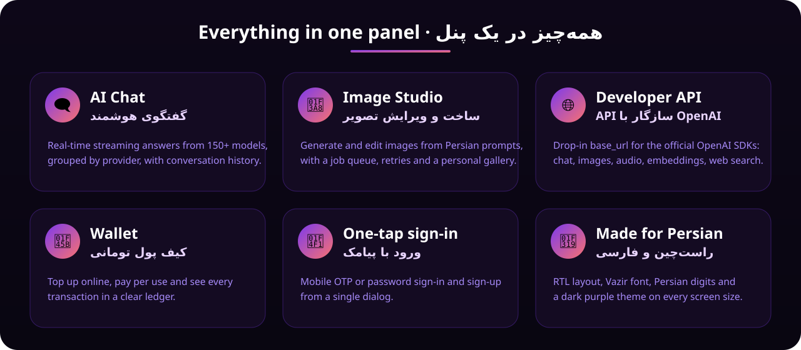

<p align="center">
  <a href="https://lemura.ir"></a>
</p>

<p align="center">
  <a href="https://lemura.ir"></a>
  
  
  
</p>

<div dir="rtl">

## ⚡ لمورا چیست؟

**هوش مصنوعی لمورا** یک پلتفرم فارسی هوش مصنوعی است: یک پنل تمام‌صفحه که در آن می‌توانی با ده‌ها مدل
هوش مصنوعی گفتگو کنی، تصویر بسازی و ویرایش کنی، برای برنامه‌هایت کلید API بگیری و هزینه‌ها را از
کیف پول تومانی خودت پرداخت کنی؛ همه با رابط راست‌چین، فونت وزیر و تم تیره بنفش.

<p align="center"><b>👈 همین حالا امتحان کن: <a href="https://lemura.ir">lemura.ir</a></b></p>

> [!NOTE]
> این مخزن فقط **بخش فرانت‌اند** لمورا است: قالب‌های صفحه (Jinja2)، استایل‌ها، اسکریپت‌های مرورگر و فونت‌ها.
> کد سرور، پنل مدیریت، درگاه پرداخت، اتصال پیامک، کلیدها و تنظیمات عمداً در این مخزن **نیستند**.

</div>

<p align="center">
  <a href="https://lemura.ir"></a>
</p>

<div dir="rtl">

## ✨ امکانات

| | بخش | توضیح |
|:-:|---|---|
| 🗨️ | **گفتگوی هوشمند** | پاسخ‌های زنده و جریانی (streaming) از بیش از ۱۵۰ مدل، دسته‌بندی بر اساس سازنده، تاریخچه گفتگو |
| 🎨 | **استودیو تصویر** | ساخت و ویرایش تصویر با متن فارسی، صف پردازش، تلاش مجدد خودکار و گالری شخصی |
| 🌐 | **کنسول API** | کلیدهای `lsk-` اختصاصی و مستندات کامل؛ سازگار با کتابخانه رسمی OpenAI |
| 👛 | **کیف پول** | شارژ آنلاین به تومان، پرداخت به اندازه مصرف و دفتر تراکنش‌های شفاف |
| 📱 | **ورود و ثبت‌نام** | ورود با کد یک‌بار مصرف پیامکی یا رمز عبور، همه در یک پنجره |
| 👤 | **پروفایل** | تصویر پروفایل، نام نمایشی و تغییر رمز |

</div>

## 🧑‍💻 Developer API · <span dir="rtl">API برای توسعه‌دهندگان</span>

Lemura exposes an **OpenAI-compatible** gateway. Point the official SDK at Lemura and use your
`lsk-` key from the **API** tab of the panel — nothing else changes.

```python
from openai import OpenAI

client = OpenAI(base_url="https://lemura.ir/wp-json/lemuraai/v1", api_key="lsk-YOUR-KEY")

reply = client.chat.completions.create(
    model="gpt-4o-mini",
    messages=[{"role": "user", "content": "سلام! یک شعر کوتاه درباره پاییز بنویس."}],
    stream=True,
)
for chunk in reply:
    print(chunk.choices[0].delta.content or "", end="")
```

| Endpoint | Purpose |
|---|---|
| `POST /chat/completions` · `/responses` | Chat, with streaming |
| `POST /images/generations` | Image generation |
| `POST /audio/speech` · `/audio/transcriptions` | Text-to-speech and speech-to-text |
| `POST /embeddings` · `/moderations` | Embeddings and moderation |
| `POST /web-search` · `/web-scrape` · `/research` | Live web search, page reading and research |
| `POST /videos` | Video generation (create, remix, download) |
| `GET /models` · `/balance` · `/usage` | Model list, wallet balance, usage history |

<div dir="rtl">

> هزینه هر درخواست به تومان از کیف پول کم می‌شود و در تب **کیف پول** قابل مشاهده است.

</div>

## 🗂️ Repository layout · <span dir="rtl">ساختار مخزن</span>

```text
templates/
├── base.html            # page shell: RTL, theme colour, global toast + Persian number helpers
├── panel.html           # full-screen user panel: sidebar, tabs, balance, mobile menu
└── tabs/
    ├── chat.html        # AI chat (home)
    ├── imagen.html      # image studio
    ├── api_console.html # API keys + documentation
    ├── wallet.html      # wallet, top-up, transactions
    ├── profile.html     # avatar, display name, password
    ├── login_modal.html # OTP / password / sign-up dialog
    └── login_req.html   # "sign in to continue" placeholder
static/
├── css/   theme.css · panel.css · chat.css
├── js/    chat.js (streaming chat) · vision.js (image jobs) · login.js (sign-in dialog)
├── fonts/ Vazir (Light · Regular · Medium · Bold, woff2)
└── img/   avatar.svg
```

## 🎨 Design tokens · <span dir="rtl">رنگ‌ها و فونت</span>

| Token | Value | |
|---|---|---|
| Background | `#090611` |  |
| Accent | `#7C3AED` |  |
| Accent (deep) | `#753E79` |  |
| Coral | `#F87171` |  |
| Font | **Vazir** | <span dir="rtl">راست‌چین، اعداد فارسی</span> |

## 🛠️ Tech · <span dir="rtl">فناوری</span>

- **Templates:** Jinja2 (rendered by a Python / Flask backend that is not part of this repository)
- **Front-end:** dependency-free vanilla JavaScript and CSS, Server-Sent Events for streaming
- **Layout:** RTL-first, responsive from phones to wide screens, dark theme

<div dir="rtl">

## 🔒 امنیت

در این مخزن هیچ کلید، رمز، اطلاعات درگاه پرداخت یا پنل پیامک وجود ندارد. اگر مشکل امنیتی در
[lemura.ir](https://lemura.ir) پیدا کردی، لطفاً آن را به‌صورت خصوصی گزارش کن و در Issues عمومی منتشر نکن.

---

<p align="center">
  ساخته‌شده با 💜 برای کاربران فارسی‌زبان<br>
  <a href="https://lemura.ir"><b>lemura.ir</b></a>
</p>

</div>

<sub>Vazir font © Saber Rastikerdar, released under the SIL Open Font License 1.1.</sub>
